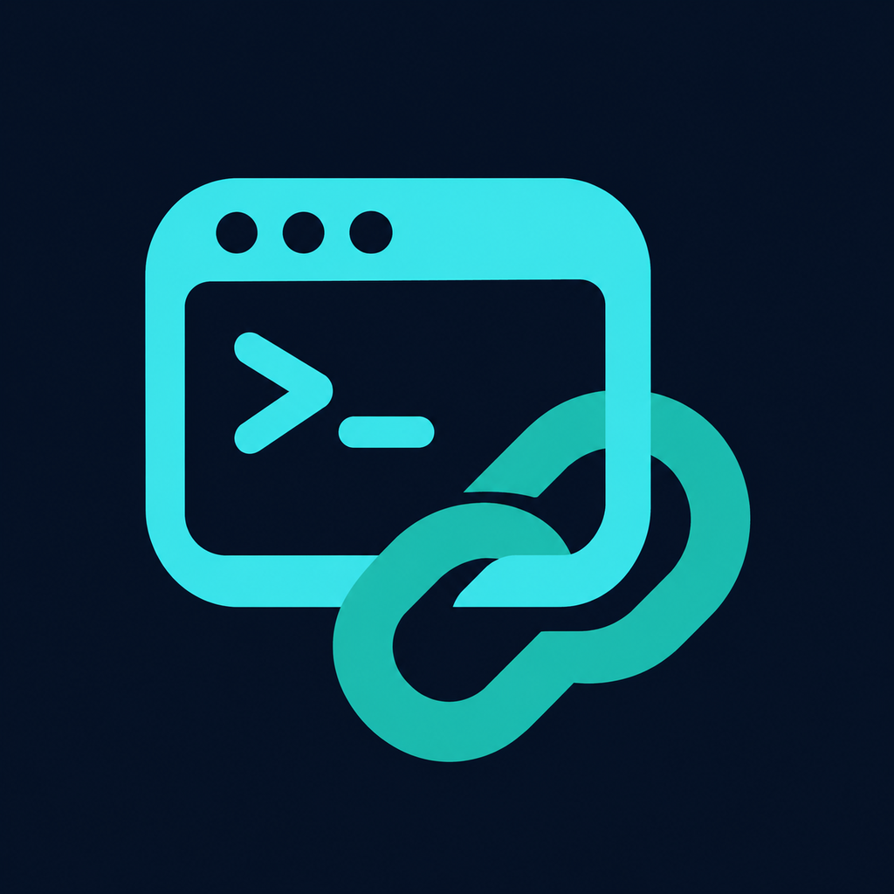
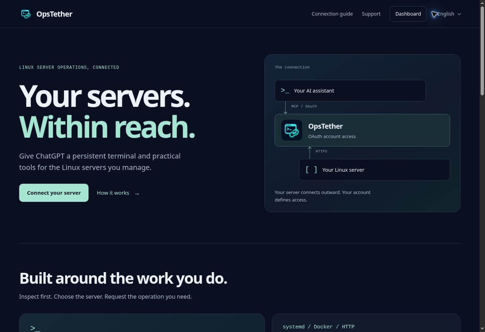

# OpsTether — Linux Server Management over MCP

Connect ChatGPT to your Linux servers through the **Model Context Protocol (MCP)** and OAuth. Inspect system health, work in persistent terminals, manage systemd services and Docker containers, and operate on files through the OpsTether hosted service.

[Website](https://opstether.m2g.pro/) · [Dashboard](https://opstether.m2g.pro/dashboard) · [Getting started](docs/GETTING_STARTED.md) · [Service docs](https://opstether.m2g.pro/docs) · [Telegram support](https://t.me/OpsTetherBot?start=support)

This repository is the public documentation showcase for a **proprietary hosted service**. Backend and agent/client source code are not distributed here. See [Proprietary notice](PROPRIETARY_NOTICE.md).

**Status:** public beta, accessed through the website and a direct MCP connection. OpsTether is not listed in the OpenAI Directory. Custom MCP availability depends on your client account, plan and workspace permissions.

## What OpsTether provides

- Persistent terminal sessions that retain the working directory, environment and interactive process state between tool calls.
- Shell execution, system resource inspection and process management.
- systemd service status, logs and administrative actions.
- Docker inspection and container operations.
- File and directory operations, HTTP health checks, usage reporting and audit metadata.
- An outbound agent connection, so OpsTether does not require an inbound SSH port.

OAuth connects your AI client to your OpsTether account. Server access is scoped to the authenticated organization. Use the same account in the dashboard and your AI client to access your paired servers.

## Connect ChatGPT

1. Open the [dashboard](https://opstether.m2g.pro/dashboard) and sign in or create an account.
2. Select **Connect server**, review the generated installation command, and run it on a Linux server you are authorized to administer.
3. Where custom MCP is available in ChatGPT, open **Plugins → + → Add custom MCP server**. Use `https://opstether.m2g.pro/mcp`, choose OAuth and enter client ID `opstether-chatgpt`. Leave the client secret empty. Complete sign-in with the same OpsTether account.
4. Ask the client to list your connected servers, then request the operation you need.

Read the [Getting started guide](docs/GETTING_STARTED.md) for the exact scopes, callback and connection checks. Other OAuth clients require a compatible client registration; automatic registration is disabled.

## Example requests

Start by identifying the intended server, then ask for a bounded operation:

| Task | Example request |
| --- | --- |
| Server inventory | “List my connected servers and show which are online.” |
| System health | “Show CPU, memory, disk usage and uptime on this server.” |
| Service diagnosis | “Show the nginx service status and its last 50 journal lines.” |
| Containers | “List Docker containers, then inspect the container I select.” |
| Persistent shell | “Open a terminal in my project directory and run `pwd`. Keep the session open.” |
| HTTP check | “Check `https://example.com` from this server and report the status and latency.” |

Service and container operations require the corresponding software to be present on the selected server. Access and usage limits follow the current account entitlement shown in the dashboard.

## Administrative access

The Linux installation flow requires explicit acceptance of **root access**. A connected AI can then run programs, modify or delete files, change system and network configuration, and stop services with the privileges of the agent. Review the installation command and authorize only the actions you intend to perform. Use OpsTether only on infrastructure you own or are authorized to administer.

See [Security](SECURITY.md) for reporting guidance and the access model.

## Service and support

| Resource | Link |
| --- | --- |
| Hosted service | [opstether.m2g.pro](https://opstether.m2g.pro/) |
| Dashboard | [Open dashboard](https://opstether.m2g.pro/dashboard) |
| Service documentation | [Docs](https://opstether.m2g.pro/docs) |
| Support | [Support instructions](https://opstether.m2g.pro/support) |
| Privacy | [Privacy policy](https://opstether.m2g.pro/privacy) |
| Terms | [Service terms](https://opstether.m2g.pro/terms) |
| Security | [Service security information](https://opstether.m2g.pro/security) |

For help, open [@OpsTetherBot](https://t.me/OpsTetherBot?start=support), use `/support`, and send the question you want to share with the service operator. Replies are delivered through the bot. Keep passwords, access tokens, private keys and installation credentials out of support messages.

## Languages

The public website opens in English. Its home page, connection guide, support, privacy, terms and security pages are also available in Russian, Spanish, Portuguese, German, French, Simplified Chinese, Arabic, Hindi and Turkish. Use the language menu to keep the page you are reading; Arabic uses a right-to-left layout.

The Telegram bot offers the same ten languages through `/language`. The account dashboard is currently in English, and the connection guide preserves the actual English interface labels used during setup.
